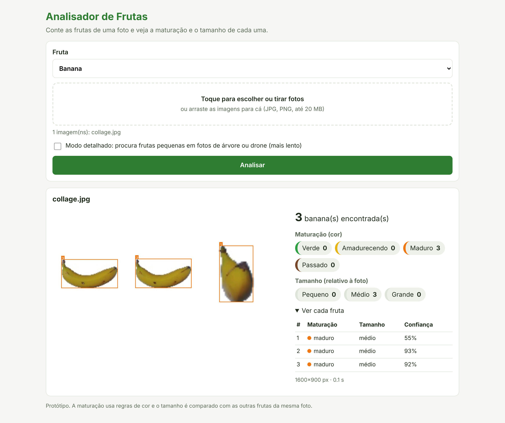

# Analisador de Frutas

Protótipo de app web que conta as frutas de uma foto e classifica cada uma por
**maturação** (verde, amadurecendo, maduro, passado) e **tamanho** (pequeno,
médio, grande). Funciona no PC, tablet e celular, e roda em uma VPS pequena
(1 vCPU, 2 GB de RAM) com Docker.



## Estado atual (etapa 1)

| Fruta   | Situação |
|---------|----------|
| Banana  | disponível |
| Laranja | disponível |
| Tomate  | depois do treino da etapa 2 |

- **Contagem:** detector YOLO11n pré-treinado no COCO, exportado para ONNX
  (`models/coco_yolo11n.onnx`, 10 MB). Roda só com ONNX Runtime, sem PyTorch.
- **Maturação:** regras de cor em HSV no centro de cada fruta
  (`backend/app/ripeness.py`).
- **Tamanho:** relativo às outras frutas da mesma foto
  (`backend/app/size.py`). Uma foto sozinha não informa o tamanho real.
- **Modo detalhado:** divide a imagem em blocos para achar frutas pequenas em
  fotos de árvore ou drone. É cerca de 5 vezes mais lento.

### Limitações conhecidas

- O modelo COCO costuma marcar um **cacho de bananas como uma só caixa**. A
  contagem de bananas individuais melhora com o modelo treinado da etapa 2.
- Em fotos da árvore, **folhas dentro da caixa** puxam a maturação para
  "verde". O modelo da etapa 2 classifica a maturação diretamente.

## Rodar com Docker

```bash
docker compose up -d --build
# abra http://localhost:8000
```

O container usa cerca de 170 MB de RAM e analisa uma foto em 0,1 a 1 s
(medido com limite de 1 CPU). As análises são feitas uma por vez.

Na VPS de 2 GB, recomenda-se criar swap antes do build:

```bash
sudo fallocate -l 2G /swapfile && sudo chmod 600 /swapfile
sudo mkswap /swapfile && sudo swapon /swapfile
echo '/swapfile none swap sw 0 0' | sudo tee -a /etc/fstab
```

Configurações por variável de ambiente (`docker-compose.yml`):
`CONF_THRESHOLD`, `IOU_THRESHOLD`, `MAX_IMAGE_SIDE`, `MAX_UPLOAD_MB`,
`ONNX_THREADS`, `MODEL_PATH`.

## Desenvolvimento local

```bash
cd backend
python -m venv .venv && . .venv/bin/activate
pip install -r requirements-dev.txt
uvicorn app.main:app --reload     # http://localhost:8000
pytest
```

## API

- `GET /api/fruits`: frutas e disponibilidade.
- `POST /api/analyze` (multipart): `file` (imagem), `fruit` (`banana`,
  `laranja`), `tiled` (`true`/`false`). Retorna total, contagem por maturação e
  tamanho, cada detecção e a imagem anotada em base64.
- Documentação interativa em `/docs`.

## Estrutura

```
backend/app/     API (FastAPI), detector ONNX, regras de cor e tamanho
backend/tests/   testes (pytest)
frontend/        app web (HTML, CSS e JS, sem build)
models/          modelos ONNX
scripts/         utilitários (exportar modelo)
```

## Próximas etapas

2. Treino no Google Colab com datasets públicos (banana, laranja, tomate e
   estágios de maturação), exportando um YOLO nano para ONNX.
3. Cadastro dinâmico de novas frutas a partir de fotos de referência.
4. Relatórios, histórico e guia de deploy completo.

## Licença do modelo

O YOLO11 é da Ultralytics, sob licença **AGPL-3.0**. Usar os pesos ou o código
deles num serviço web exige disponibilizar o código-fonte do serviço, ou obter
uma licença comercial da Ultralytics.
